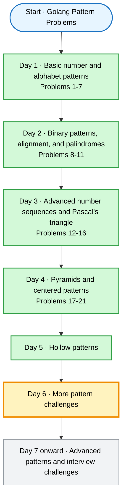

# Golang Pattern Problems

A collection of classic **number / alphabet / star pattern** problems written in Go while learning loops and nested loops.

Every file is a standalone `package main` program, so each one is compiled and run separately.

## Learning plan

| Day | Topics | Status |
|---|---|---|
| Day 1 | Basic number and alphabet patterns | Covered |
| Day 2 | Binary patterns, alignment, and palindromes | Covered |
| Day 3 | Advanced number sequences and Pascal's triangle | Covered |
| Day 4 | Pyramids and centered patterns | Covered |
| Day 5 | Hollow patterns | Covered |
| **Day 6** | **More pattern challenges** | **Today's lesson** |
| Day 7 onward | Advanced patterns and interview challenges | Upcoming |

### Course flowchart



**Legend:** green = covered · grey = upcoming

## Problems

| # | Day | File | Pattern |
|---|-----|------|---------|
| 1 | 1 | [`main.go`](main.go) | Right-angled star triangle |
| 2 | 1 | [`repeated_number_triangle.go`](repeated_number_triangle.go) | Repeated number triangle |
| 3 | 1 | [`descending_number_triangle.go`](descending_number_triangle.go) | Descending number triangle |
| 4 | 1 | [`floyd_triangle.go`](floyd_triangle.go) | Floyd's triangle |
| 5 | 1 | [`increasing_aplhabet_triangle.go`](increasing_aplhabet_triangle.go) | Increasing alphabet triangle |
| 6 | 1 | [`repeated_alphabet_triangle.go`](repeated_alphabet_triangle.go) | Repeated alphabet triangle |
| 7 | 1 | [`inverted_alphabet_triangle.go`](inverted_alphabet_triangle.go) | Inverted / constant alphabet triangle |
| 8 | 2 | [`binary_triangle.go`](binary_triangle.go) | Binary (0/1) triangle |
| 9 | 2 | [`alternating_binary_square.go`](alternating_binary_square.go) | Alternating binary checkerboard square |
| 10 | 2 | [`right_aligned_number_triangle.go`](right_aligned_number_triangle.go) | Right-aligned (pyramid) number triangle |
| 11 | 2 | [`palindrome_number_triangle.go`](palindrome_number_triangle.go) | Palindrome number triangle |
| 12 | 3 | [`continous_Alphabet_Triangle.go`](continous_Alphabet_Triangle.go) | Continuous alphabet triangle |
| 13 | 3 | [`alternative_Number_Alphabet_Rows.go`](alternative_Number_Alphabet_Rows.go) | Alternating number / alphabet rows |
| 14 | 3 | [`increasing_Starting_Number_triangle.go`](increasing_Starting_Number_triangle.go) | Increasing starting number triangle |
| 15 | 3 | [`multiplication_Triangle.go`](multiplication_Triangle.go) | Multiplication triangle |
| 16 | 3 | [`pascal_triangle.go`](pascal_triangle.go) | Pascal's triangle |
| 17 | 4 | [`centered_number_pyramid.go`](centered_number_pyramid.go) | Centered number pyramid |
| 18 | 4 | [`centerd_Star_Pyramid.go`](centerd_Star_Pyramid.go) | Centered star pyramid |
| 19 | 4 | [`inverted_centered_star_pyramid.go`](inverted_centered_star_pyramid.go) | Inverted centered star pyramid |
| 20 | 4 | [`full_Diamond.go`](full_Diamond.go) | Full diamond |
| 21 | 4 | [`centered_alphabet_pyramid.go`](centered_alphabet_pyramid.go) | Centered alphabet pyramid |
| 22 | 5 | [`hollow_right_Triangle.go`](hollow_right_Triangle.go) | Hollow right triangle |
| 23 | 5 | [`hollow_square.go`](hollow_square.go) | Hollow square |
| 24 | 5 | [`hollow_rectangle.go`](hollow_rectangle.go) | Hollow rectangle |
| 25 | 5 | [`hollow_pyramid.go`](hollow_pyramid.go) | Hollow pyramid |
| 26 | 5 | [`hollow_diamond.go`](hollow_diamond.go) | Hollow diamond |

---

## Day 1 — Basic number and alphabet patterns

### 1. Right-angled star triangle — `main.go`

Prints `i` stars on row `i`.

```text
*
**
***
****
*****
******
```

### 2. Repeated number triangle — `repeated_number_triangle.go`

Each row prints the row index repeatedly.

```text
0
11
222
3333
44444
555555
```

### 3. Descending number triangle — `descending_number_triangle.go`

Rows go from `5` down to `1`, each row counting down.

```text
 5 4 3 2 1
 4 3 2 1
 3 2 1
 2 1
 1
```

### 4. Floyd's triangle — `floyd_triangle.go`

Consecutive natural numbers filling successive rows.

```text
 1
 2 3
 4 5 6
 7 8 9 10
 11 12 13 14 15
 16 17 18 19 20 21
```

### 5. Increasing alphabet triangle — `increasing_aplhabet_triangle.go`

Continuous run of letters, incrementing across the whole triangle without restarting each row.

```text
A
B C
D E F
G H I J
K L M N O
P Q R S T U
```

### 6. Repeated alphabet triangle — `repeated_alphabet_triangle.go`

Each row prints one letter repeated.

```text
A
B B
C C C
D D D D
E E E E E
F F F F F F
```

### 7. Inverted / constant alphabet triangle — `inverted_alphabet_triangle.go`

The intended shape is a shrinking triangle that repeats `A` on each row. The current program
does not produce that pattern: its outer loop decrements from zero while testing `i <= 5`, so
it never terminates, and `fmt.Print` formats the rune as the number `65`.

## Day 2 — Binary patterns, alignment, and palindromes

### 8. Binary triangle — `binary_triangle.go`

`1` and `0` alternating based on `(i+j) % 2`, in a triangle.

```text
1
0 1
1 0 1
0 1 0 1
1 0 1 0 1
0 1 0 1 0 1
```

### 9. Alternating binary square — `alternating_binary_square`

Checkerboard of `1` / `0` over a full 6×6 square.

```text
1 0 1 0 1 0 1
0 1 0 1 0 1 0
1 0 1 0 1 0 1
0 1 0 1 0 1 0
1 0 1 0 1 0 1
0 1 0 1 0 1 0
```

### 10. Right-aligned number triangle — `right_aligned_number_triangle.go`

Pyramid shape: leading spaces pad the left side so numbers line up on the right.

```text
        1
      1 2
    1 2 3
  1 2 3 4
1 2 3 4 5
```

### 11. Palindrome number triangle — `palindrome_number_triangle.go`

Each row counts up then back down, forming a palindrome, with left padding.

```text
    1
   212
  32123
 4321234
543212345
```

## Day 3 — Advanced number sequences and Pascal's triangle

### 12. Continuous alphabet triangle — `continous_Alphabet_Triangle.go`

A single running alphabet (`A`…`U`) spread across growing rows, one letter per cell.

```text
 A
 B C
 D E F
 G H I J
 K L M N O
 P Q R S T U
```

### 13. Alternating number / alphabet rows — `alternative_Number_Alphabet_Rows.go`

Rows alternate: even rows print numbers from a running counter, odd rows print letters.

```text
 A
 1 2
 B C D
 3 4 5 6
 E F G H I
```

### 14. Increasing starting number triangle — `increasing_Starting_Number_triangle.go`

Each row starts one higher than the previous and counts up.

```text
 1
 2 3
 3 4 5
 4 5 6 7
 5 6 7 8 9
 6 7 8 9 10 11
```

### 15. Multiplication triangle — `multiplication_Triangle.go`

Row `i` prints the multiples of `i` from `i` up to `i × i`.

```text
 1
 2 4
 3 6 9
 4 8 12 16
 5 10 15 20 25
 6 12 18 24 30 36
```

### 16. Pascal's triangle — `pascal_triangle.go`

Binomial coefficients, built with the recurrence `val = val * (i - j) / j`.

```text
 1
 1 1
 1 2 1
 1 3 3 1
 1 4 6 4 1
```

## Day 4 — Pyramids and centered patterns

### 17. Centered number pyramid — `centered_number_pyramid.go`

Each row restarts at `1` and grows by two numbers. The left padding is derived from the
widest row, so every row sits on the same centre axis.

```text
        1
      1 2 3
    1 2 3 4 5
  1 2 3 4 5 6 7
1 2 3 4 5 6 7 8 9
```

### 18. Centered star pyramid — `centerd_Star_Pyramid.go`

An odd number of stars per row, centered with left padding.

```text
         *
       ***
      *****
     *******
    *********
   ***********
  *************
```

### 19. Inverted centered star pyramid — `inverted_centered_star_pyramid.go`

The centered star pyramid flipped vertically, shrinking from the top.

```text
 *********
  *******
   *****
    ***
     *
```

### 20. Full diamond — `full_Diamond.go`

A centered star pyramid joined to its mirror image, forming a diamond.

```text
     *
    ***
   *****
  *******
 *********
  *******
   *****
    ***
     *
```

### 21. Centered alphabet pyramid — `centered_alphabet_pyramid.go`

The alphabet twin of problem 17: each row restarts at `A` and grows by two letters, centred
on the same axis.

```text
        A
      A B C
    A B C D E
  A B C D E F G
A B C D E F G H I
```

## Day 5 — Hollow patterns

These patterns print stars along their borders and spaces through their interiors.

### 22. Hollow right triangle — `hollow_right_Triangle.go`

Prints the left and right edges, plus the bottom edge, of a right triangle.

```text
*
**
* *
*  *
*   *
******
```

### 23. Hollow square — `hollow_square.go`

Prints a square with a solid star border.

```text
******
*    *
*    *
*    *
*    *
******
```

### 24. Hollow rectangle — `hollow_rectangle.go`

Prints a six-row by three-column rectangle with a solid star border.

```text
***
* *
* *
* *
* *
***
```

### 25. Hollow pyramid — `hollow_pyramid.go`

Prints the two sloping edges and a solid base.

```text
    *
   * *
  *   *
 *     *
*********
```

### 26. Hollow diamond — `hollow_diamond.go`

Prints a hollow diamond with a single star at the top and bottom.

```text
    *
   * *
  *   *
 *     *
*       *
 *     *
  *   *
   * *
    *
```

## Day 5 — Hollow patterns

### 22. Hollow rectangle — `hollow_rectangle.go`

```text
******
*    *
***
```
*(example shown with l=6, b=3)*

### 23. Hollow square — `hollow_square.go`

```text
******
*    *
*    *
*    *
*    *
*    *
******
```
*(example shown with n=5)*

### 24. Hollow right-angled triangle — `hollow_right_Triangle.go`

```text
*
**
* *
*  *
*****
```
*(example shown with n=5)*

### 25. Hollow pyramid — `hollow_pyramid.go`

```text
    *
   * *
  *   *
 *     *
*********
```
*(example shown with n=5)*

### 26. Hollow diamond — `hollow_diamond.go`

```text
    *
   * *
  *   *
 *     *
*       *
 *     *
  *   *
   * *
    *
```
*(example shown with n=5)*

---

## Concepts practised

- Nested `for` loops
- Loop-controlled vs. counter-controlled iteration
- `fmt.Print` / `fmt.Println` / `fmt.Printf` formatting
- Arithmetic (`%`) and character (`'A'`) manipulation
- Boundary conditions for hollow patterns
